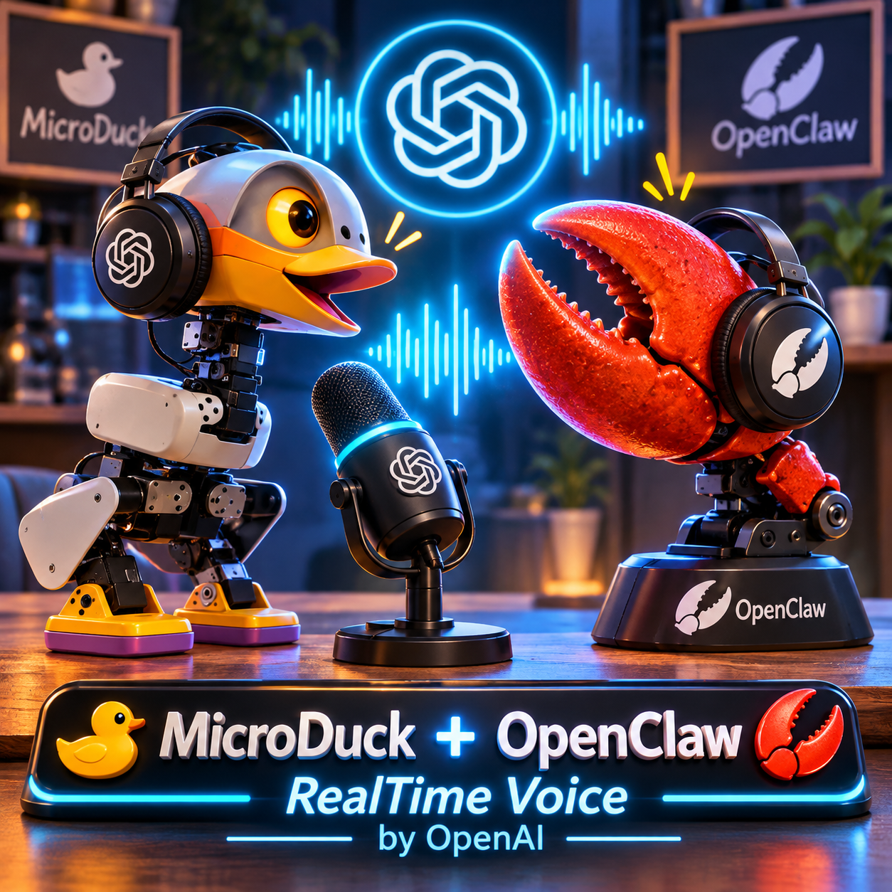

# Coin-Coin

<p align="center">
  
</p>

**A real-time voice companion for a little robot duck.**

Coin-Coin connects browser audio, OpenAI Realtime conversation, camera snapshots
and bounded robot actions. Say **"Coin coin"**, talk naturally, interrupt a reply,
ask the duck to move or look around, and hear its answer while its beak moves.
Optional OpenClaw integration provides long-term memory.

> [!WARNING]
> **Experimental; not validated on physical hardware.** Some simulator walking
> checks still fail. A command being accepted is not proof of physical movement,
> and a visual beak animation is not validation of a real servo. Do not use this
> project to operate unsupervised hardware.

## Features

| Capability | What it does |
|---|---|
| Local wake detection | Vosk recognizes "Coin coin"; Silero detects speech before audio is forwarded to Realtime. |
| Real-time conversation | Streams microphone audio and spoken replies, with live transcripts and interruption. |
| Language preferences | Follows the user's language by default. `RESPONSE_LANGUAGE` sets an optional preferred language without changing code. Tool announcements follow the conversation language. |
| Robot actions | Move, turn, stop, look, change posture, sit, stand and run advertised skills through a safety governor. |
| Vision | Retrieves a camera snapshot when asked what the robot sees. |
| Voice and expression | Configurable Realtime voice (`verse` by default), audio-synchronized mouth commands and a local quack sound bank. |
| Optional memory | OpenClaw tools for recalling and storing facts; unavailable explicitly when not configured. |
| Browser diagnostics | Echo and tone modes work without an API key, wake models or robot connection. |

The public code and instructions use English; the robot is not forced to speak
English or French. A requested voice style is playful, warm and witty. Perceived
age, gender and character still depend on the selected voice and the listener.

## Architecture

```text
Browser microphone -> local wake/VAD -> OpenAI Realtime -> browser speakers
                              |                |
                        conversation state     +-> tool calls
                                                   |
                     camera <- TCP relay <- safety governor -> robot commands
                                    |
                           MicroDuck simulator/runtime
```

The relay bridges allowlisted JSON-RPC requests to MicroDuck's Unix sockets.
The governor bounds speed and movement duration, streams movement setpoints,
checks fresh robot safety state and stops on completion or hazards. The robot's
deadman is a separate last line of defense if communication disappears.
TCP is the default transport. WebRTC (`webrtc://host:8443`) is the path a
delivered robot exposes: mediad signalling plus a `control` DataChannel carrying the
same JSON-RPC, with the camera as a video track and no relay. See
[Connecting to a robot](#connecting-to-a-robot).

The simulator and runtime are **separate repositories**, not bundled dependencies.
The simulator's optional visual-mouth support animates a private render model:
collision geometry, inertia, policy observations and physics remain unchanged.
It does not measure a real mouth joint.

## Requirements

- Python **3.12+** and [uv](https://docs.astral.sh/uv/).
- A recent browser, microphone and speakers/headphones. Browser microphone access
  requires localhost or a secure HTTPS context.
- An OpenAI API key with access to the configured Realtime model for real
  conversation. API usage can incur charges.
- Vosk French/English wake models and Silero VAD for normal voice operation.
  Wake-model languages are separate from the conversation language.
- A prepared MicroDuck runtime and simulator for robot actions.

The one-command simulator launcher requires **Linux or WSL2**, Cargo, util-linux
(`setpriv`), GStreamer with `webrtcsink` and `x264enc`, and the simulator's Python
environment, policies and system dependencies. A GUI-capable environment
(for example WSLg) is needed for the MuJoCo window; `--headless` skips that window
but still renders camera frames. Follow the runtime/simulator setup instructions
first; the launcher is not a dependency installer.

## Quick start: browser audio only

```sh
git clone https://github.com/Wylhelm/coin-coin.git
cd coin-coin
uv sync --locked
test -e .env || cp .env.example .env
uv run coincoin --echo --host 127.0.0.1
```

Open <http://localhost:8765/>, enable listening and grant microphone access.
Echo mode plays microphone audio back; headphones avoid acoustic feedback.
`uv run coincoin --tone --host 127.0.0.1` provides a tone/latency check instead.
Stop with `Ctrl+C`.

## One-command simulator stack

Arrange prepared checkouts as follows, or pass explicit paths:

```text
workspace/
  coin-coin/
  microduck/       # Pollen Robotics runtime, including scripts/duck-sim
  microduck_rl/    # Wylhelm simulator fork, develop branch, own .venv/policies
```

Clone the repositories from the workspace directory:

```sh
mkdir -p workspace && cd workspace
git clone https://github.com/Wylhelm/coin-coin.git coin-coin
git clone https://github.com/pollen-robotics/microduck.git microduck
git clone --branch develop https://github.com/Wylhelm/microduck_rl.git microduck_rl
```

The runtime comes from the upstream
[Pollen Robotics `microduck`](https://github.com/pollen-robotics/microduck)
repository. The visual beak animation is currently published only in
[Wylhelm's `microduck_rl` fork on `develop`](https://github.com/Wylhelm/microduck_rl/tree/develop);
no pull request for that change has been submitted to Pollen Robotics. The
upstream simulator may therefore not include the visual-mouth animation, and
cloning upstream alone does not guarantee it will appear.

The live check documented below used a local `microduck` checkout whose
`scripts/duck-sim` had already been modified for WSL GPU parameters. It did
**not** test a fresh, unmodified clone of the upstream runtime; that clone may
need an equivalent WSL/GPU adjustment before the simulator starts. The
Coin-Coin launcher does not install or apply that runtime-specific change.

In the Coin-Coin checkout:

1. Prepare `.env` from `.env.example` and set `OPENAI_API_KEY`. Never commit it.
2. Install wake/VAD models with `sh scripts/download_wake_models.sh`.
   This downloads files and replaces an existing Silero model; inspect the script first.
3. Optionally install your local WAV bank under `assets/sounds/` for quacks.
   Missing sounds disable quacks, not conversation.
4. Check prerequisites, then start:

```sh
# No services or API requests are started by --check.
uv run --no-sync python scripts/live_stack.py --check

# Starts simulator + camera, local TCP relay and Coin-Coin.
uv run --no-sync python scripts/live_stack.py

# Example: longer simulated moves and an explicit language preference.
uv run --no-sync python scripts/live_stack.py --max-move-s 30 --language French

# Different checkout locations / no viewer:
uv run --no-sync python scripts/live_stack.py \
  --runtime /path/to/microduck --rl /path/to/microduck_rl --headless

# Use a detailed custom scene and preload both equipment models:
uv run --no-sync python scripts/live_stack.py --scene /path/to/scene.xml --preload-equipment

# Add named places so the duck can be sent to rooms of that scene:
uv run --no-sync python scripts/live_stack.py --scene /path/to/scene.xml \
  --preload-equipment --places /path/to/navigation.json

# Closer to a real robot: WebRTC link, a known start, simulator imperfections,
# obstacles from a file, no simulation-only hand (equipment must be fitted):
uv run --no-sync python scripts/live_stack.py --link webrtc --scene /path/to/scene.xml \
  --places /path/to/navigation.json --start départ@0 --realism real --realism-seed 7 \
  --obstacles /path/to/obstacles.json [--obstacle-slots N] [--no-assist] [--maploc]
```

`--realism off|real|hard`, `--realism-seed`, `--no-assist`, `--obstacles` and
`--obstacle-slots` export the simulator's `DUCK_SIM_*` variables before the body server
starts (realism is `off` unless asked); `--maploc` turns on robotd's mapping and
localization. See `microduck_rl` for what each does.

For convenient voice equipment changes in simulation, add `--sim-auto-equipment`.
It fits/removes skates through the stack's local simulator socket, then waits for mode
confirmation and homing. It cannot be combined with `--no-assist`; on hardware a person
still fits/removes the skates and selects the mode. The WebRTC route is unchanged.

`--places` loads a navigation map (clearance grid and named places, produced by
`salon_scan/build_navigation.py`) and enables the `go_to` tool: "Va dans ma
chambre" or "Reviens" plan a route around obstacles with A* and follow it in
closed loop. By default the duck steers by an **estimated pose** built only from
what a real duck has: contact odometry, the IMU and the head's 8x8 ToF depth
frames, matched against the map by a particle filter. `--start départ@0` gives
the known start (the apartment scene spawns the duck at the dock); without it the
duck sweeps its head and refuses if it cannot place itself. The simulator's true
pose is read only to score the estimate, or to steer when `--oracle-pose` is
given. The duck stops before unmapped obstacles seen by the ToF, marks them and
replans, sweeps its head to relocalize when uncertain, and stops and says so when
it is lost or the way is blocked (a closed door). Skates are refused in honest
mode. See [honest localization](docs/localization.md) for the model, measured
errors and limits; nothing is validated on hardware.
Room navigation refuses to start unless `robot.policies` explicitly reports a
simulated robot. The duck commands a stop before replanning after four seconds
without movement or rotation, or twelve seconds without progress. It gives up if
the same route fails again from the same spot or after at most three replans,
and stops after 300 s at most. Voice or browser STOP, falls and stale state stop
it as for any other motion.

The optional `--preload-equipment` compiles walking and roller equipment models
for the single duck at startup. This uses more memory and startup time, but
avoids recompiling a detailed scene during a mode change. The runtime and
simulator checkouts must support `DUCK_SIM_PRELOAD_EQUIPMENT` and
`--preload-equipment`.

Open <http://localhost:8765/> once **LIVE READY** appears. Enable the microphone,
say **"Coin coin"**, then try "Introduce yourself", "Look left" or "What do you see?".
With `--max-move-s 30`, "Move forward for ten seconds" is within the allowed limit.
Keep the terminal open. **Ctrl+C shuts down this stack**, including the simulator.
A stop requested during simulator startup waits for its launcher to finish before cleanup.

The launcher:

- Reserves the simulator lock and refuses occupied ports instead of stopping
  someone else's services.
- Uses a fresh, short state directory under `~/.cache/cc-live-*`.
  Its path and service logs are printed; logs are retained after shutdown.
- Forces the robot and camera links to its local simulator, binds the relay and
  Coin-Coin UI to loopback, disables OpenClaw and raw-audio logging, and uses streamed quacks.
- Uses the runtime's native `duck-sim` path, not Docker or real hardware, with
  privilege escalation disabled. The runtime may compile its Rust binaries.
- Checks HTTP readiness and watches the relay/app processes. `/healthz` only
  proves the web server is alive, not that microphone audio or the API works.
- Stops its own child processes and calls identity-checked simulator cleanup.
  If cleanup fails, the lock is retained and the error is reported. Do not delete
  a lock until you have verified that its services are no longer running.

No secrets or machine-specific checkout paths are stored in the example launcher.
For GStreamer installed outside the standard search paths, export `GST_PLUGIN_PATH`
before launching. The known `/opt/gst-plugins-rs/lib/gstreamer-1.0` installation is
detected if present.

### Controls and movement limits

Ask **"Coin coin, mets tes patins et patine vers l'avant pendant deux secondes"**
to select `roller` and then move, or **"Reviens a la marche"** to select `walk`.
Switching modes stops motion first, waits for confirmation, and keeps that mode
until another request changes it. You can alternate repeatedly in one session.
Skating uses the roller safety limits (no lateral command, yaw at most 0.3 rad/s).
For manual diagnostics, use `coincoin-cli mode roller` or `coincoin-cli mode walk`.

The simulation needs matching runtime and RL checkouts with **body protocol 2**:
the runtime selects the correct policy bundle and the simulator swaps the actual
foot/skate models, including passive wheels and collisions. During the transition,
the simulator steadies the trunk through the home ramp and briefly while the new
gait takes over, then releases it. Walking and skating use real contact physics,
without that support. This is an assisted simulation transition, not an autonomous
balance or equipment-changing skill. The local policy set must contain `roller.onnx` and
`roller_crouch.onnx`; `duck-sim` selects it with `[policy] directory` rather than a
walking-slot override. Restart the local stack once after updating both checkouts.
On real hardware, mode selection does **not** physically fit or remove skates;
that equipment must be changed by a person before selecting its mode. The upstream
[LAN WebRTC route](https://github.com/pollen-robotics/microduck/blob/main/mediad/src/route.rs)
currently refuses remote `robot.setMode`, so the physical robot may require a
local mode selection; confirm the procedure for its installed release.

If the simulated duck has fallen, **"Releve-toi"** retries its current mode's
assisted home ramp; **"Reviens a la marche"** also removes the skates. Success
requires fresh upright state and a completed ramp, not just an accepted request.
This recovery is available only when `robot.policies` reports `simulated: true`;
real-robot fall, pickup, stale-state and STOP protections remain in force.

| Action | Behavior |
|---|---|
| Say "Coin coin" | Wakes local listening and opens a Realtime conversation. |
| Speak during a reply | Interrupts playback and lets you continue. |
| Voice `stop` tool | Stops robot motion but keeps the conversation open. |
| Browser **STOP** | Stops robot/audio, ends the conversation and returns to sleep. |
| Say goodbye / ask it to sleep | Calls the sleep tool. |
| `Ctrl+C` in the launcher | Shuts down the whole test stack. |

`MAX_MOVE_S` is a **per-command safety ceiling**, not a robot limitation. The
repository default is **5 seconds**. Set it in `.env`, or pass `--max-move-s 30`
to the launcher, to allow ten- or thirty-second moves. The same value is exposed
in the model's tool schema and enforced by the governor; over-limit requests are
bounded and reported. The governor still stops at the deadline, on STOP, on stale
safety state or on a detected hazard. Longer commands do not make walking more reliable.

For multi-step requests, `move` and `turn` finish before the next queued robot
action begins; time spent waiting in the queue does not consume an action's
execution deadline. Voice or browser STOP bypasses the queue and cancels pending
steps. A completed movement means the commanded interval or turn ended; it does
not prove how far a physical robot travelled. Other actions such as skills may
only report that they were accepted.

## Configuration

Settings are loaded from `.env`; environment variables take precedence.
Restart the service after changing them.

| Setting | Default / purpose |
|---|---|
| `OPENAI_API_KEY` | Required for real conversation; keep private. |
| `OPENAI_REALTIME_MODEL` | `gpt-realtime-2.1`; access depends on your account. |
| `OPENAI_REALTIME_VOICE` | `verse`; explicitly configured voices remain supported. |
| `RESPONSE_LANGUAGE` | `auto`: follow the user. Examples: `English`, `French`, `Spanish`. Explicit spoken language requests take precedence during a conversation. |
| `ROBOT_LINK`, `FRAME_LINK` | TCP robot/camera endpoints; the test launcher overrides both to localhost. |
| `ROBOT_TARGET`, `ROBOT_HOST`, `ROBOT_SIGNALLING_PORT` | Empty: use `ROBOT_LINK`. `sim` (host defaults to `127.0.0.1`) or `robot` (host required: duck name or IP) selects `webrtc://ROBOT_HOST:8443`. |
| `PERSON_MODE_TIMEOUT_S` | `120`: how long the duck waits for a person to change its mode when the link refuses `robot.setMode`. |
| `SIM_EQUIPMENT_SOCKET` | Empty: no automatic equipment help. `--sim-auto-equipment` fills the owned simulator socket; never configure this for hardware. |
| `RELAY_TOKEN` | Shared TCP relay token. Empty is permitted for loopback-only simulation, not remote exposure. |
| `MAX_VX`, `MAX_VY`, `MAX_VYAW` | Walk limits: `0.25 m/s`, `0.2 m/s`, `1 rad/s`. |
| `MIN_VX`, `MIN_VY`, `MIN_VYAW` | Walk floors: `0.3 m/s`, `0.15 m/s`, `1 rad/s`. Policy v9 stands still below about 0.2 m/s and 0.8 rad/s, so a nonzero walking speed below its floor is raised to it (never above the limit: with the default `MAX_VX` the forward floor is effectively 0.25 m/s; set `MAX_VX=0.3` to use it). The tool result and the journal say so. Not applied on skates (roller yaw is capped at 0.3 rad/s). `0` disables a floor. |
| `MAX_MOVE_S`, `MOVE_HZ` | Maximum command duration `5 s`; command streaming `20 Hz`. |
| `NAV_MAP`, `SIM_POSE_LINK` | Empty: no `go_to`. Navigation map and simulator body-server address; set together by `--places`. |
| `NAV_POSE`, `NAV_START`, `TOF_LINK` | `estimated` (odometry + ToF, default) or `oracle` (simulator truth, evaluation only); known start such as `départ@0` (empty: unknown); ToF source: a relay `tcp://` endpoint, or `link` to subscribe to `tof.stream` over the WebRTC robot link itself. `--places` sets them (`link` with `--link webrtc`). |
| `NAV_GLOBAL_RELOCALIZATION` | `true`: with no usable estimate, sweep the head and match the whole flat; refuse (`location_ambiguous`) when two places fit equally well. `false`: relocalize only near the last estimate, and refuse an unknown start. |
| `WAKE_ENGINE`, `WAKE_THRESHOLD` | `vosk`, `0.9`; threshold remains provisional. |
| `FOLLOWUP_S` | Conversation follow-up timeout, `420 s`. |
| `QUACK_SINK` | `stream` (browser output) or `robot`. |
| `OPENCLAW_URL`, `OPENCLAW_TOKEN`, `OPENCLAW_AGENT` | Optional memory integration; the test launcher disables it. |
| `LOG_AUDIO`, `LOG_RETENTION_DAYS` | Raw audio disabled by default; logs retained for `30` days. |

## Connecting to a robot

One profile switch, one check:

```sh
ROBOT_TARGET=sim uv run coincoin-cli doctor                          # simulator mediad
ROBOT_TARGET=robot ROBOT_HOST=192.0.2.10 uv run coincoin-cli doctor  # delivered duck (`duckctl ip`)
```

`doctor` checks, in order: configuration, host resolution, the signalling port, the
mediad producer, the WebRTC link, the API version, `robot.policies`, sim versus real
target, capabilities, health and battery, the state stream, command latency, and the
camera. It prints a fix for each failing step and exits nonzero on failure; `--json` is
machine readable. Put the same two variables in `.env` to run Coin-Coin itself
against that target. `scripts/live_stack.py --link webrtc` runs the local stack over
the same path, without the TCP relay.

At connect time Coin-Coin probes what the robot actually allows. The LAN WebRTC route
refuses `robot.setMode`. When that is the case and you ask for skates or walking, the
duck says that a person must fit or remove the equipment and select the mode on the
robot (today `sudo robotctl configure` → `[policy] mode`, then restart robotd). It then
waits for `robot.state` to report the new mode, up to `PERSON_MODE_TIMEOUT_S`, and
refuses every movement meanwhile. Voice or browser STOP cancels the wait. Sim-only tools
(`go_to` with the simulator's oracle pose, assisted get-up) are offered only when
`robot.policies` reports `simulated: true`. If the link is lost, motion stops, the link
reconnects with a backoff capped at 10 s, and capabilities are probed again. In the
simulator, `scripts/sim_person_mode.py roller` plays the person's part.

For a manually managed robot/relay setup, configure the links and token, start
the relay separately, then run `uv run coincoin --host 127.0.0.1`.
See [delivery notes](docs/delivery.md), [OpenClaw integration](docs/openclaw.md)
and [WebRTC limitations](docs/webrtc.md). Historical technical reports may be in French.

## Current validation and limitations

The November 6, 2026 live simulator session exercised conversation, interruption,
camera descriptions, looking, postures, skills, movement, sleep and browser STOP.
The operator confirmed the `verse` voice, moving visual beak and consistent
French conversation/tool announcements with the local language preference.
The Realtime `look` schema was corrected to remove an unsupported root `oneOf`;
direction-vs-coordinate exclusivity is still checked locally.

Known open points are not hidden by that successful interaction:

- A strict `0.2 m/s` / `2 s` walk measured about **0.131 m**, below the required
  **> 0.15 m**. Very slow walking produced almost no displacement.
- Interruption worked for the operator but still produced Realtime cancellation warnings.
- The seven-minute automatic sleep observation was interrupted and is **not validated**.
- OpenClaw was disabled in the live test; its real gateway is not validated.
- No physical robot, servo synchronization or acoustic robustness is validated.
- The full Docker/Compose assembly is not validated. The WebRTC path is validated against
  the simulator's mediad only; no physical robot has been reached over it.

## Development

Offline checks use local doubles for external services:

```sh
uv run ruff check .
uv run ruff format --check .
uv run pyright
uv run pytest
node --test tests/js/play_worklet.test.mjs
```

Node.js is needed only for the browser audio tests above. Simulator/model-dependent
tests require their explicit prerequisites; skipped tests are not evidence of
live behavior. Keep genuine failed measurements instead of relaxing thresholds.
With the sibling runtime and simulator prepared, a built `robotd` and the scanned
apartment assets available, the room-navigation rehearsal is opt-in:

```sh
DUCK_TEST_NAVIGATION_SIM=1 uv run --no-sync pytest -q -s \
  tests/integration/test_navigation_simulation.py \
  tests/integration/test_navigation_honest_simulation.py \
  -p no:cacheprovider --no-cov --basetemp="$HOME/.cache/nvt/t"
```

The honest run prints estimated-vs-true pose error per leg and appends a JSON line
per leg to `$DUCK_NAV_RESULTS` if set. A short `--basetemp` keeps robotd's Unix
socket path under the kernel limit. Hold the shared simulator lock if other agents
use the machine (`flock /tmp/microduck-sim-agents.lock ...`).

GitHub Actions runs these offline checks on pull requests and pushes to `main`,
using Python 3.12 and Node.js 22 without OpenAI or robot credentials. CI does not
validate the simulator or physical hardware. Pull requests normally require
code-owner review and passing CI; an administrator can explicitly bypass these
requirements through a pull request.

| Directory | Contents |
|---|---|
| `src/coincoin/` | App, browser UI, audio pipeline, tools, robot governor and memory. |
| `relay/` | Allowlisted TCP bridge to runtime Unix sockets. |
| `scripts/` | Model/corpus utilities and the reusable live-stack launcher. |
| `tests/` | Unit, integration, browser-audio and opt-in simulator tests. |
| `docs/` | Technical decisions, historical evidence and operating procedures. |

## Privacy and network safety

Wake detection is local. During an active conversation, microphone audio and
requested camera images are sent to the configured OpenAI service. Optional
OpenClaw memory sends conversation-derived data to its gateway. Raw-audio logging
is off by default, but application logs can contain transcripts and tool results;
keep them private.

Direct `coincoin` startup still binds to all interfaces unless `--host` is set.
Use loopback for local testing. The TCP relay has no TLS and WebRTC signaling is
not authenticated; do not expose them to the Internet. Docker/Compose is optional
and is not used by the one-command launcher.

## License

No license has been selected for this repository yet.
